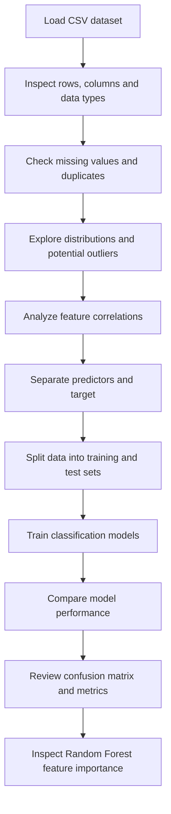

<div align="center">

# 🧠 Parkinson's Disease Prediction

### Machine Learning Classification with Voice-Derived Biomedical Features

<p>
  
  
  
  
</p>

**An end-to-end machine learning project exploring whether voice measurements can help distinguish Parkinson's disease samples from control samples.**

[Overview](#-project-overview) · [Dataset](#-dataset-at-a-glance) · [Workflow](#-project-workflow) · [Models](#-machine-learning-models) · [Results](#-model-performance) · [Run Locally](#-run-the-project) · [Interview Guide](#-interactive-project-guide)

</div>

---

## 📌 Project Overview

Parkinson's disease is a progressive neurological disorder that can affect movement, speech, and other functions. Changes in voice characteristics have been studied as potential signals associated with the condition.

This project uses a labelled dataset of biomedical voice measurements to build and compare supervised machine learning classifiers. The target variable, `status`, has two classes:

- **`1` — Parkinson's disease group**
- **`0` — Control group**

The notebook follows a typical data science workflow: data loading, data-quality checks, exploratory data analysis (EDA), correlation analysis, model training, and performance evaluation.

> **Important:** This is an educational machine learning project, not a medical diagnostic tool. Predictions from this model must not be used to diagnose, rule out, or treat Parkinson's disease. Clinical use would require independent validation and assessment by qualified healthcare professionals.

## 🎯 Project Objectives

- Explore a structured biomedical voice dataset using Python.
- Inspect data quality, distributions, potential outliers, and feature relationships.
- Understand relationships among voice measurements using correlation analysis.
- Train and compare multiple classification algorithms.
- Evaluate model predictions using accuracy, confusion matrices, precision, recall, and F1-score.
- Examine feature importance to better understand the fitted Random Forest model.
- Practice communicating findings and limitations in a reproducible data science workflow.

## 📊 Dataset at a Glance

| Property | Description |
|---|---|
| Observations | 195 |
| Total columns | 24 |
| Identifier | `name` |
| Target | `status` |
| Predictor features | 22 numerical features after excluding `name` and `status` |
| Problem type | Supervised binary classification |
| Data domain | Biomedical voice measurements |

The dataset contains numerical features derived from voice recordings. The `name` column identifies a recording and is excluded from the model input. The `status` column provides the label the model learns to predict.

### Feature glossary

<details>
<summary><strong>🎙️ Frequency measurements</strong></summary>

| Feature | Meaning |
|---|---|
| `MDVP:Fo(Hz)` | Average vocal fundamental frequency |
| `MDVP:Fhi(Hz)` | Maximum vocal fundamental frequency |
| `MDVP:Flo(Hz)` | Minimum vocal fundamental frequency |

</details>

<details>
<summary><strong>〰️ Jitter measurements</strong></summary>

Jitter features describe variations in fundamental frequency across successive vocal cycles.

| Feature | Meaning |
|---|---|
| `MDVP:Jitter(%)` | Frequency variation as a percentage |
| `MDVP:Jitter(Abs)` | Absolute jitter measure |
| `MDVP:RAP` | Relative average perturbation |
| `MDVP:PPQ` | Pitch period perturbation quotient |
| `Jitter:DDP` | Difference-of-differences perturbation measure |

</details>

<details>
<summary><strong>🔊 Shimmer measurements</strong></summary>

Shimmer features describe variations in vocal amplitude.

| Feature | Meaning |
|---|---|
| `MDVP:Shimmer` | Shimmer measure |
| `MDVP:Shimmer(dB)` | Shimmer expressed in decibels |
| `Shimmer:APQ3` | Three-period amplitude perturbation quotient |
| `Shimmer:APQ5` | Five-period amplitude perturbation quotient |
| `MDVP:APQ` | Amplitude perturbation quotient |
| `Shimmer:DDA` | Difference-of-differences amplitude measure |

</details>

<details>
<summary><strong>📈 Noise and nonlinear measurements</strong></summary>

| Feature | Meaning |
|---|---|
| `NHR` | Noise-to-harmonics ratio |
| `HNR` | Harmonics-to-noise ratio |
| `RPDE` | Recurrence period density entropy |
| `DFA` | Detrended fluctuation analysis measure |
| `spread1`, `spread2` | Nonlinear measures of signal variation |
| `D2` | Nonlinear measure associated with signal complexity |
| `PPE` | Pitch period entropy |

These measurements describe signal characteristics. Their statistical association with the dataset's labels does not establish a cause or a clinical diagnosis.

</details>

## 🔄 Project Workflow



### 1. Data loading and inspection

The dataset is loaded with Pandas. Initial inspection uses:

- `head()` to preview records.
- `shape` to inspect dataset dimensions.
- `info()` to review data types and non-null counts.
- `describe()` to summarize numerical variables.

### 2. Data quality checks

The notebook checks for duplicate rows and missing values using Pandas. In the provided dataset, all columns have 195 non-null values, and the exact duplicate-row count is zero.

### 3. Exploratory Data Analysis

Boxplots are used to compare numerical feature distributions across the two target classes and to flag potential outliers for investigation.

EDA is useful for understanding distributions and identifying observations that may deserve further review. A potential outlier is not automatically an erroneous observation.

### 4. Correlation analysis

A correlation matrix and heatmaps help visualize linear relationships among numerical variables. A scatterplot with a fitted regression line provides a closer look at selected feature pairs.

**Example finding:** `spread1` and `PPE` have a Pearson correlation coefficient of approximately **0.962** in this dataset, indicating a strong positive linear association.

This finding describes a relationship between features; it does not establish causation or prove that either feature is independently responsible for a prediction.

### 5. Feature and target separation

- **Predictors (`X`):** 22 numerical voice features.
- **Target (`y`):** `status`.
- **Excluded column:** `name`, because it serves as a recording identifier.

### 6. Model training and evaluation

The data is split into training and testing subsets. Classifiers are fitted on training data and evaluated on held-out test observations.

The notebook compares multiple algorithms and examines confusion matrices, accuracy, and class-level classification metrics.

## 🤖 Machine Learning Models

| Algorithm | How it works | Why compare it? |
|---|---|---|
| Decision Tree | Learns a sequence of feature-based splits | Interpretable rules and nonlinear patterns |
| Random Forest | Combines predictions from multiple decision trees | Ensemble learning and feature-importance analysis |
| K-Nearest Neighbors (KNN) | Predicts from the labels of nearby training samples | Distance-based classification baseline |
| AdaBoost | Combines sequentially trained weak learners | Boosting-based classification comparison |
| Support Vector Machine (SVM) | Learns a decision boundary between classes | Margin-based classification, including nonlinear boundaries with suitable kernels |

Comparing several algorithms helps illustrate how different learning strategies behave on the same classification task. Model selection should consider appropriate validation, class-specific metrics, and the intended use case—not accuracy alone.

## 📈 Model Performance

The initial 70:30 train-test experiment produced the following accuracy scores:

| Model | Test accuracy |
|---|---:|
| **Random Forest** | **93.22%** |
| Decision Tree | 89.83% |
| AdaBoost | 89.83% |
| K-Nearest Neighbors | 83.05% |
| Support Vector Machine | 81.36% |

The Random Forest result corresponds to 55 correctly classified observations out of 59 test observations in the reported run.

> **How to interpret this result:** These are results from a particular train-test split. They are useful for an educational comparison, but do not guarantee performance on new populations or establish clinical readiness.

### Evaluation metrics

<details>
<summary><strong>Accuracy</strong></summary>

The proportion of predictions that match the actual labels.

`Accuracy = (TP + TN) / (TP + TN + FP + FN)`

Accuracy gives an overall summary, but can conceal differences in how well each class is identified when the classes are imbalanced.

</details>

<details>
<summary><strong>Precision</strong></summary>

Of the observations predicted as positive, the proportion that are actually positive.

`Precision = TP / (TP + FP)`

</details>

<details>
<summary><strong>Recall / Sensitivity</strong></summary>

Of the actual positive observations, the proportion correctly identified.

`Recall = TP / (TP + FN)`

</details>

<details>
<summary><strong>F1-score</strong></summary>

The harmonic mean of precision and recall.

`F1 = 2 × (Precision × Recall) / (Precision + Recall)`

</details>

<details>
<summary><strong>Confusion matrix</strong></summary>

A confusion matrix summarizes true positives, true negatives, false positives, and false negatives. It helps explain the types of errors made by a classifier.

For a medical research context, false negatives and false positives have different implications, so evaluation should include class-specific metrics.

</details>

### Class distribution

The target classes are not evenly represented. In the training split shown in the notebook, approximately 75.7% of observations belong to class `1` and 24.3% belong to class `0`.

For this reason, accuracy should be considered alongside class-specific precision, recall, F1-score, and potentially balanced accuracy. Further validation is important because the dataset is small.

## 🔍 Feature Importance

Random Forest provides feature-importance scores that can be visualized in a bar chart. These scores estimate how features contribute to splits within the fitted forest.

Feature importance can help prioritize variables for further investigation, but it has important limitations:

- Correlated features can share or redistribute importance.
- Impurity-based importance can favor certain feature types or split patterns.
- Importance does not establish causality.
- Statistical importance in a model is not the same as clinical importance.

The project explores features such as fundamental frequency measures, `spread1`, and `PPE` as part of the voice-feature analysis.

## 🛠️ Technology Stack

| Tool / Library | Purpose |
|---|---|
| Python | Programming language |
| NumPy | Numerical arrays and calculations |
| Pandas | Data loading, inspection and manipulation |
| Matplotlib | Plotting and figure customization |
| Seaborn | Statistical visualizations, boxplots and heatmaps |
| SciPy | Pearson correlation and statistical testing |
| Scikit-learn | Data splitting, model training and evaluation |
| Jupyter Notebook | Interactive analysis and experimentation |

## 🚀 Run the Project

### Prerequisites

- Python 3.x
- Jupyter Notebook or JupyterLab
- The project notebook
- The `parkinsons.csv` dataset file

### 1. Clone the repository

Replace the placeholder with the URL of your repository.

```bash
git clone <YOUR_REPOSITORY_URL>
cd <YOUR_REPOSITORY_FOLDER>
```

### 2. Create and activate a virtual environment (recommended)

**Windows:**

```bash
python -m venv .venv
.venv\Scripts\activate
```

**macOS / Linux:**

```bash
python3 -m venv .venv
source .venv/bin/activate
```

### 3. Install dependencies

```bash
python -m pip install numpy pandas matplotlib seaborn scipy scikit-learn jupyter
```

### 4. Place the dataset

Ensure `parkinsons.csv` is in the directory expected by the notebook, or update the file path used by `pd.read_csv()`.

### 5. Launch Jupyter Notebook

```bash
jupyter notebook
```

Open the project notebook and run the cells in order, starting with imports and data loading.

## 📁 Suggested Repository Structure

```text
parkinsons-disease-prediction/
├── README.md
├── parkinsons.csv
└── parkinsons_disease_prediction.ipynb
```

If your actual notebook or dataset has a different filename or location, adjust this structure to match your repository.

## 🧠 Interactive Project Guide

Use the expandable sections below to revise the concepts behind the project.

<details>
<summary><strong>1. Why is this a classification problem?</strong></summary>

The target `status` contains two categories, `0` and `1`. The task is to predict a category rather than a continuous numerical value, making it a binary classification problem.

</details>

<details>
<summary><strong>2. Why remove the name column?</strong></summary>

The `name` column identifies recordings and is not one of the intended voice measurements. Excluding it helps prevent an identifier from being treated as a predictive signal.

</details>

<details>
<summary><strong>3. Why perform EDA before training?</strong></summary>

EDA helps understand data quality, distributions, unusual observations and relationships between variables. It informs subsequent preprocessing and modeling decisions.

</details>

<details>
<summary><strong>4. Why compare several classifiers?</strong></summary>

Different algorithms learn patterns in different ways. A consistent comparison helps identify promising candidates and understand trade-offs in performance and interpretability.

</details>

<details>
<summary><strong>5. Why is Random Forest a useful model here?</strong></summary>

It can capture nonlinear relationships and interactions between features, combines multiple trees, and offers feature-importance estimates. Its performance still needs to be assessed with appropriate validation.

</details>

<details>
<summary><strong>6. Why is accuracy not enough?</strong></summary>

The target classes are imbalanced. A model could perform well overall while missing a disproportionate number of observations from one class. Precision, recall, F1-score and the confusion matrix provide more detail.

</details>

<details>
<summary><strong>7. What would you improve next?</strong></summary>

I would use stratified cross-validation, scale inputs for distance- and margin-based models, tune hyperparameters within training data, compare class-specific metrics, and assess the final model on independent data. If multiple recordings belong to the same participant, I would also consider participant-level data splitting.

</details>

<details>
<summary><strong>8. Is this model suitable for clinical diagnosis?</strong></summary>

No. It is an educational model built on a small labelled dataset. Clinical use would require rigorous independent validation, representative samples, assessment by healthcare professionals, and appropriate governance.

</details>

## ⚠️ Limitations and Future Improvements

### Current limitations

- The dataset contains only 195 observations.
- The class distribution is imbalanced.
- Several predictors are strongly correlated.
- A single train-test split provides limited evidence about generalization.
- Feature importance does not establish causal or clinical significance.
- The model has not been established as a clinically validated diagnostic system.

### Future improvements

- Use stratified cross-validation for model comparison.
- Apply `StandardScaler` through a scikit-learn pipeline for SVM and KNN.
- Tune hyperparameters using cross-validation.
- Compare class-specific recall, precision, F1-score and balanced accuracy.
- Evaluate the selected model on an independent dataset.
- Investigate participant-level splitting where recording identifiers permit it.
- Document model versions, experiment settings and reproducible results.

## 💼 Skills Demonstrated

- **Data analysis:** loading, inspecting and summarizing structured data.
- **Data quality:** missing-value and duplicate checks.
- **Exploratory analysis:** feature distributions, boxplots and correlation heatmaps.
- **Statistics:** Pearson correlation and p-value interpretation.
- **Machine learning:** training and comparing supervised classification algorithms.
- **Evaluation:** accuracy, confusion matrices, precision, recall and F1-score.
- **Data storytelling:** communicating findings, assumptions and limitations.

## 👩‍💻 About the Project

This project was developed as a machine learning learning exercise to practice Python-based data analysis and classification on biomedical voice measurements.

If you use, adapt, or extend this project, please cite the dataset source and respect its original license and terms of use.

---

<div align="center">

**Built with Python, curiosity, and a data-driven mindset.**

*For research and educational purposes only — not for medical diagnosis.*

</div>
